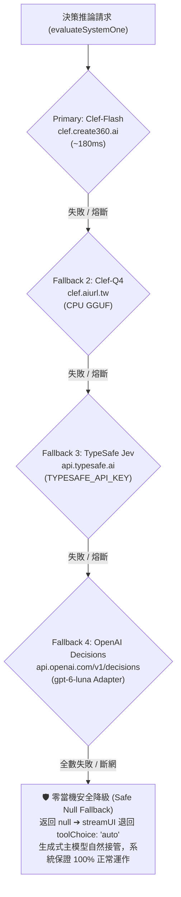

# 02. System One 決策推論引擎架構 (Decision Engine Architecture)

## 1. ⚡ 理念與三層漸進決策架構 (Tiered Decision Pipeline)

Stockbot 導入「快思考決策模型（System 1 Decision Engine）」，將金融軟體中的高頻意圖分類、條件閘門與評分從龐大緩慢的生成式 LLM 中抽離：

- **Tier 0（0ms）**：本地正規表達式與字典映射（明確 Ticker、SpaceX 鐵律、顯著意圖關鍵字），0ms 零網路消耗直達工具。
- **Tier 1.5（~190ms）**：[`lib/clef.ts`](../../lib/clef.ts) 調用專用決策推論 API，專精 typed choice（多選意圖分類）、noul（布林真假機率）、score（有序量化評分）。高置信度（confidence >= 0.72）直接前置鎖定 `deterministicTool`。
- **Tier 2（1.5s ~ 5s）**：大型生成式 LLM（GPT-4o-mini / Gemini-2.5-Flash / DeepSeek）專注於深度文字合成與伴隨解說；若 Tier 0 / Tier 1.5 未命中，則以 `toolChoice: 'auto'` 自然接管。

---

## 2. 🎯 四大核心落地場景 (Scenarios A / B / C / D)

- **A. 語意意圖分流閘門 (`inferSemanticToolWithClef` in [`lib/chat/routing.ts`](../../lib/chat/routing.ts))**：
  - 當 Regex 未命中時，以 190ms 評估 17 種金融工具意圖，置信度高直接鎖定 `deterministicTool`，杜絕弱模型誤調 2MD 搜尋。
  - 內建 `isPlausibleFinancialQuery`，普通閒聊問候跳過外部請求，節省延遲。
- **B. DeepEar 傳導鏈與信號證偽打分 ([`lib/deepear.ts`](../../lib/deepear.ts))**：
  - 以 Clef 進行市場衝擊情緒分數評估（-1.0 到 +1.0）與傳導方向評估，客觀輸出 `Strengthened` / `Weakened` / `Falsified` / `Unchanged` 狀態。
- **C. 13 位大師共識量化與多空衝突警報 ([`app/api/analysis-summary/route.ts`](../../app/api/analysis-summary/route.ts))**：
  - 快速評估大師多空立場（`strong_bull` 到 `strong_bear`）、衝突分歧指數（0~100）與尾部黑天鵝風險預警。
- **D. 2MD 搜尋結果關聯度與防幻覺檢核 ([`lib/research-search.ts`](../../lib/research-search.ts))**：
  - 客觀評估候選新聞文章與目標標的財務問題之具體關聯度，確保最佳數據來源置頂。

---

## 3. 🛡️ 四層高可用備援架構 (4-Tier Decision Failover)

在 [`lib/clef.ts`](../../lib/clef.ts) 中實現全自動故障轉移機制：

1. **Primary**：`https://clef.create360.ai/v1/systemone`（自建 Clef-Flash，<180ms，零 Output Token 計費）
2. **Fallback 2**：`https://clef.aiurl.tw/v1/systemone`（自建備援 CPU GGUF 節點）
3. **Fallback 3 (Jev)**：`https://api.typesafe.ai/v1/systemone`（TypeSafe 官方 Jev 服務，支援 `TYPESAFE_API_KEY`）
4. **Fallback 4 (OpenAI Decisions API)**：`https://api.openai.com/v1/decisions`（`gpt-6-luna` 專用決策推論，透過專屬 Protocol Adapter 轉換）

---

## 4. 🔌 OpenAI Decisions API 協定轉接器 (Protocol Adapter)

`lib/clef.ts` 內建專用轉接器，使上層業務代碼無縫兼容 OpenAI `/v1/decisions`：
- **`formatOpenAiInput(state)`**：將狀態物件序列化為 OpenAI Decisions 之 `input`。
- **`mapSystemOneQuestionsToOpenAi(questions)`**：
  - `choice` ➔ OpenAI `choice` (含 choices 陣列)
  - `noul` ➔ OpenAI `predicate` (條件真假機率)
  - `score` ➔ OpenAI `score` (含 levels 陣列)
- **`parseOpenAiDecisionsResponse(data, originalQuestions)`**：將 OpenAI 回傳之 answers 陣列精確映射回統一的 `ChoiceAnswer`, `NoulAnswer`, `ScoreAnswer`。

---

## 5. 🛡️ 防雪崩與零當機降級機制 (Resilience & Zero-Breakage)

- **Singleflight 請求合併**：防止同輪對話並發觸發多餘外部請求。
- **快取憑證隔離**：`cacheKey` 納入金鑰特徵指紋（`authFingerprint`），杜絕不同 BYOK 使用者跨帳號快取污染。
- **端點熔斷機制 (Circuit Breaker)**：連續 2 次失敗進入 30 秒冷卻期；當端點因無金鑰略過（`skipIfNoAuth`）時，自動重置過期熔斷紀錄。
- **全層失敗零當機安全降級**：若四層決策模型皆不可用或斷網，`evaluateSystemOne` 靜默返回 `null`，主流程自動退回大型生成式 LLM（`streamUI` toolChoice: `'auto'`），系統 100% 正常對話與調用工具。
